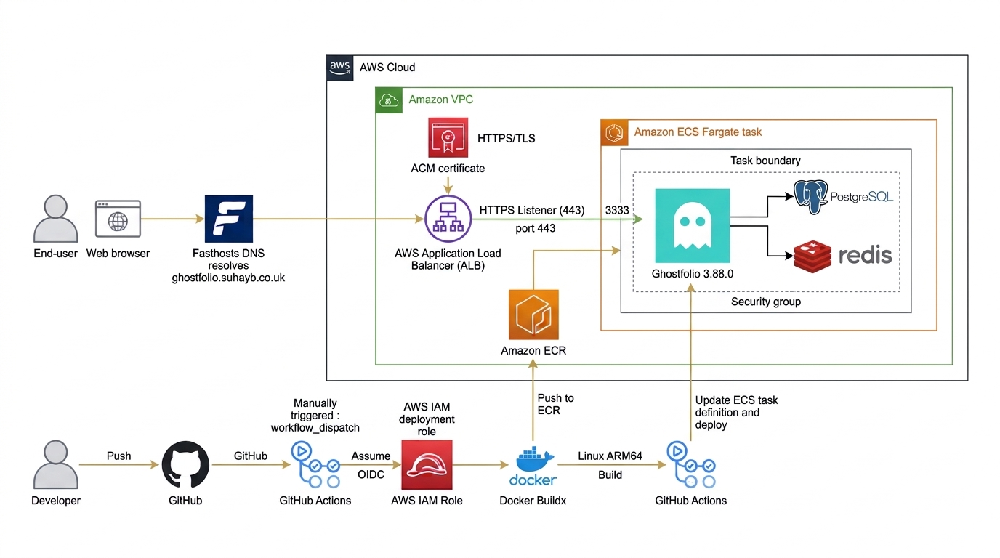
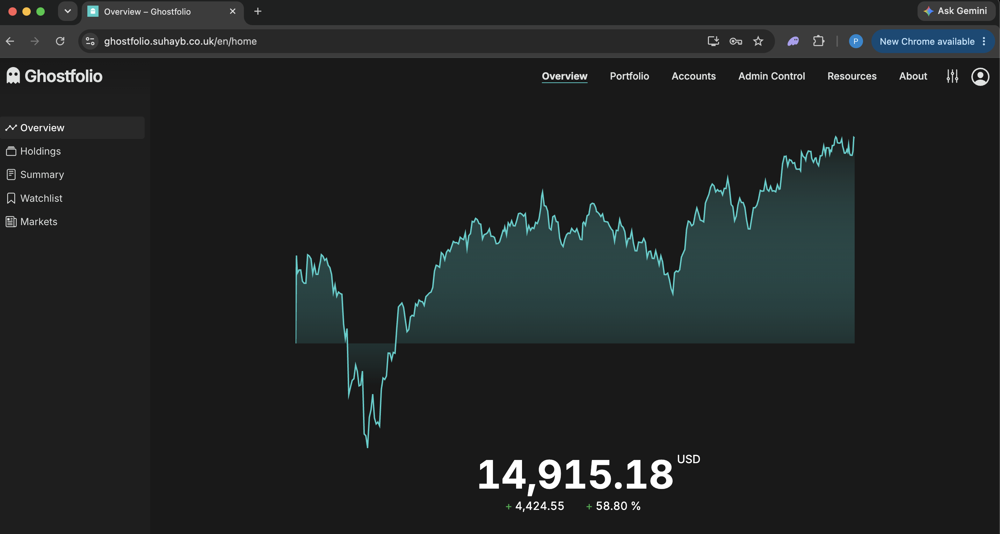
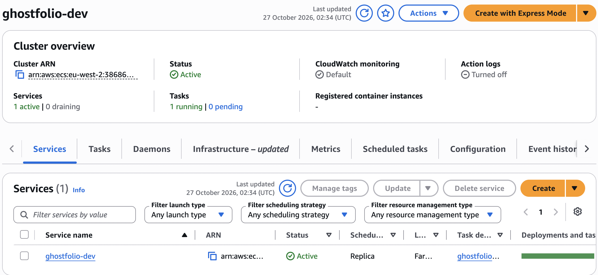
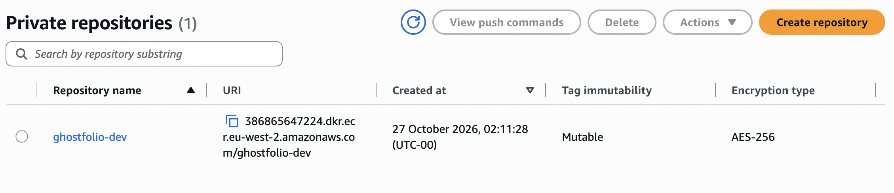
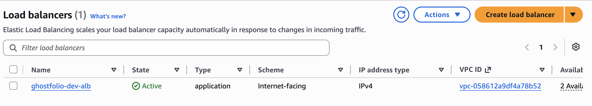
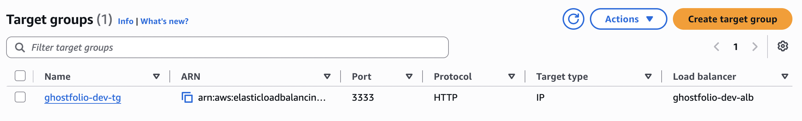
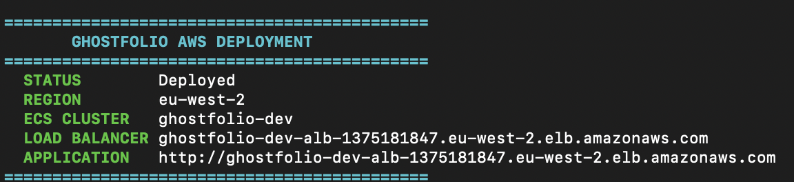

# Ghostfolio on AWS ECS Fargate

<p align="center">
  
  
  
  
  
  
  
  
  
  
  
</p>


<p align="center">
  
</p>


---

## Table of Contents

1. [Project Overview](#1-project-overview)
2. [Application URL](#2-application-url)
3. [Architecture Overview](#3-architecture-overview)
4. [Features](#4-features)
5. [Repository Structure](#5-repository-structure)
6. [Key Components](#6-key-components)
7. [Cost and Availability Decisions](#7-cost-and-availability-decisions)
8. [CI/CD Pipeline](#8-cicd-pipeline)
9. [Project Delivery](#9-project-delivery)
10. [Lessons Learned](#10-lessons-learned)
11. [Future Improvements](#11-future-improvements)

---

## 1. Project Overview

This project explores the deployment of **Ghostfolio**, an open-source personal finance and investment portfolio tracking application, to AWS.

The goal was to take an existing application and build the cloud infrastructure and deployment process around it.

I used Docker to package the application, Terraform to define the AWS infrastructure, and GitHub Actions to automate the deployment process.

The application was designed to run on **Amazon ECS using Fargate**, with PostgreSQL for database storage and Redis for caching.

This project gave me practical experience working with containerisation, cloud infrastructure, networking, IAM permissions and CI/CD.

## 2. Application URL

**Application:** [https://ghostfolio.suhayb.co.uk](https://ghostfolio.suhayb.co.uk)

The application was configured to use a custom subdomain, with DNS managed through Fasthosts.

HTTPS was handled using AWS Certificate Manager and an Application Load Balancer.

<p align="center">
  
</p>

## 3. Architecture Overview

The architecture is built around two main flows: application traffic and the deployment process.

### Application traffic

1. A user accesses the application through the custom domain.
2. Fasthosts DNS directs the request towards the AWS Application Load Balancer.
3. The load balancer handles HTTPS traffic using an ACM certificate.
4. Traffic is forwarded to the Ghostfolio container running on ECS Fargate.
5. Ghostfolio communicates with PostgreSQL and Redis within the ECS task.

### Deployment flow

1. A deployment is manually triggered through GitHub Actions.
2. GitHub Actions authenticates with AWS using OpenID Connect (OIDC).
3. Docker Buildx builds the application image for Linux ARM64.
4. The image is tagged and pushed to Amazon ECR.
5. GitHub Actions retrieves the current ECS task definition and updates it with the new image.
6. ECS deploys the updated task definition.

The architecture diagram above illustrates how these services fit together.

## 4. Features

- **Containerised application:** Ghostfolio is packaged into a Docker image.
- **AWS ECS Fargate:** Runs the application without managing EC2 instances.
- **Container registry:** Amazon ECR stores the built Docker images.
- **Database and caching:** PostgreSQL and Redis run alongside Ghostfolio in the ECS task.
- **HTTPS access:** An Application Load Balancer and AWS Certificate Manager handle secure incoming traffic.
- **Infrastructure as Code:** Terraform defines the AWS infrastructure.
- **Automated deployment:** GitHub Actions builds and deploys updated application images.
- **AWS authentication:** GitHub Actions uses OIDC to authenticate with AWS.

## 5. Repository Structure

The repository contains the Ghostfolio application, Docker configuration, Terraform infrastructure and GitHub Actions workflow.

```text
ecs-ghostfolio-project/
│
├── .github/
│   └── workflows/
│       └── deploy-aws.yml
│
├── .config/
├── apps/
├── docker/
├── libs/
├── prisma/
├── terraform/
├── tools/
│
├── Dockerfile
├── compose.yaml
├── package.json
└── README.md
```

| Directory / File | Purpose |
|---|---|
| `.github/workflows/` | Contains the GitHub Actions deployment workflow |
| `apps/` | Ghostfolio application code |
| `docker/` | Docker-related configuration and scripts |
| `libs/` | Shared application libraries |
| `prisma/` | Database schema and Prisma configuration |
| `terraform/` | AWS infrastructure configuration |
| `tools/` | Project tooling and supporting scripts |
| `Dockerfile` | Builds the Ghostfolio container image |
| `compose.yaml` | Local multi-container development setup |

## 6. Key Components

### Amazon ECS and Fargate

ECS manages the application containers, while Fargate provides the compute capacity to run them without managing EC2 instances.

<p align="center">
  
</p>

### Running Containers

The ECS task was designed to run three containers:

- Ghostfolio
- PostgreSQL
- Redis

<p align="center">
  
</p>

### Amazon ECR

Amazon Elastic Container Registry stores the Docker images used by the ECS deployment.

<p align="center">
  
</p>

### Application Load Balancer

The Application Load Balancer provides an entry point for incoming application traffic and handles HTTPS connections.

<p align="center">
  
</p>

### Target Group

The target group connects the load balancer to the application running inside ECS.

<p align="center">
  
</p>

### Terraform

Terraform was used to define and provision the AWS infrastructure.

<p align="center">
  
</p>

### Other Technologies

| Component | Role in the project |
|---|---|
| **AWS Certificate Manager** | Provides the SSL/TLS certificate for HTTPS |
| **AWS IAM** | Controls permissions for AWS services and GitHub Actions |
| **GitHub OIDC** | Allows GitHub Actions to authenticate with AWS without storing long-lived AWS access keys |
| **Docker Buildx** | Builds the application image for ARM64 |
| **PostgreSQL** | Stores application data |
| **Redis** | Provides caching |
| **Fasthosts** | Manages the project's custom domain and DNS records |

## 7. Cost and Availability Decisions

A key consideration when designing the infrastructure was choosing services that reduced the amount of server management required.

### AWS Fargate

Fargate was chosen so that I could run containers without provisioning or maintaining EC2 instances.

It also allowed the application to be deployed using a defined ECS task configuration.

### ARM64 Architecture

The Docker image was built for Linux ARM64. This allowed the deployment to target ARM-based compute rather than relying on an x86-only image.

### Application Load Balancer

The Application Load Balancer provided a single entry point for incoming application traffic and handled HTTPS termination.

It also separated public access from the application containers.

### Resource Management

The application, database and Redis were designed to run as containers within an ECS task. This kept the initial deployment architecture relatively straightforward.

The trade-off is that running multiple containers in one task means they share the task's available compute resources and lifecycle.

## 8. CI/CD Pipeline

The deployment process is handled by a GitHub Actions workflow located at:

`.github/workflows/deploy-aws.yml`

The workflow is manually triggered using `workflow_dispatch`.

### Deployment Steps

| Step | Action |
|---|---|
| 1. Trigger | Manually start the GitHub Actions workflow |
| 2. Authentication | Authenticate with AWS using GitHub OIDC |
| 3. Build | Build the Docker image using Docker Buildx |
| 4. Tag | Tag the image with the commit SHA and `latest` |
| 5. Push | Upload the image to Amazon ECR |
| 6. Task definition | Retrieve the existing ECS task definition and update the Ghostfolio container image |
| 7. Deploy | Deploy the updated task definition to the ECS service |
| 8. Wait | Wait for the ECS service to reach a stable state |

### Why Use GitHub OIDC?

Instead of storing permanent AWS access keys as GitHub secrets, OIDC allows GitHub Actions to assume an IAM role.

This avoids maintaining long-lived credentials and uses an IAM trust relationship to control access.

### Deployment Workflow

```text
Developer
    |
    v
GitHub Repository
    |
    v
GitHub Actions
    |
    v
AWS Authentication (OIDC)
    |
    v
Docker Buildx
    |
    v
Amazon ECR
    |
    v
Update ECS Task Definition
    |
    v
Deploy to ECS Fargate
```

## 9. Project Delivery

The project brought together several areas of DevOps and cloud engineering.

The main implementation work included:

- Preparing Ghostfolio for containerised deployment.
- Creating a Docker image targeting Linux ARM64.
- Defining the AWS infrastructure using Terraform.
- Configuring ECS Fargate to run Ghostfolio, PostgreSQL and Redis.
- Setting up ECR as the container image registry.
- Configuring an Application Load Balancer and HTTPS.
- Connecting a custom domain through Fasthosts DNS.
- Setting up GitHub Actions with AWS OIDC authentication.
- Creating a workflow to build, push and deploy updated images.

The result was a deployment setup that connected source control, container builds, AWS infrastructure and application deployment into one workflow.

## 10. Lessons Learned

Working through this project helped me understand how the different parts of a cloud deployment fit together.

Some of the main lessons were:

- **Containerisation:** Building an image for an existing application requires understanding its build process, dependencies and runtime configuration.
- **ECS task design:** Running multiple containers in one task requires careful consideration of networking, ports, environment variables and resource allocation.
- **IAM and OIDC:** Getting GitHub Actions to authenticate with AWS requires the correct IAM role permissions and trust relationship.
- **Networking:** Understanding how DNS, load balancers, security groups and container ports work together is essential for making an application accessible.
- **Infrastructure as Code:** Terraform makes infrastructure easier to define, review and reproduce.
- **CI/CD:** Automating image builds and deployments reduces the need for manual deployment steps and makes the process more repeatable.

## 11. Future Improvements

There are several areas where the project could be extended:

- **Automated testing:** Add tests to the GitHub Actions workflow before building and deploying the image.
- **Deployment verification:** Add an application health check after deployment to verify that Ghostfolio is responding correctly.
- **Improved rollback:** Add a clearer rollback process for failed deployments.
- **Monitoring and alerting:** Expand monitoring and create alerts for application and infrastructure issues.
- **Database backups:** Introduce a managed and automated backup strategy for PostgreSQL.
- **Secrets management:** Review and expand the use of AWS Systems Manager Parameter Store for application configuration and secrets.
- **Environment separation:** Introduce separate development and production environments.
- **Automated deployments:** Consider triggering deployments automatically when changes are merged into the main branch.

