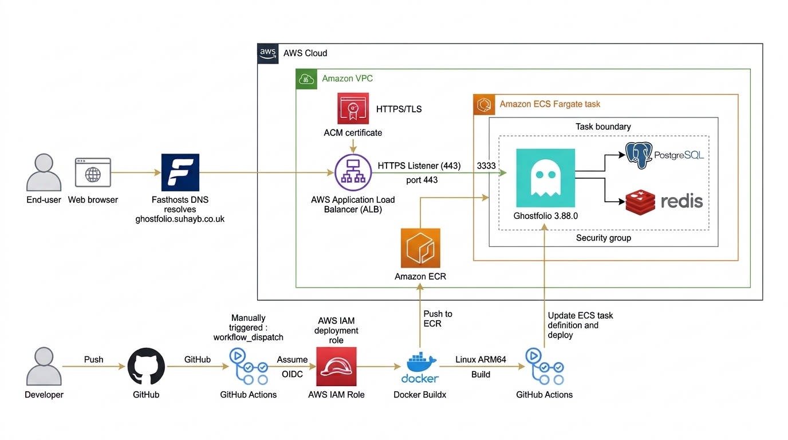
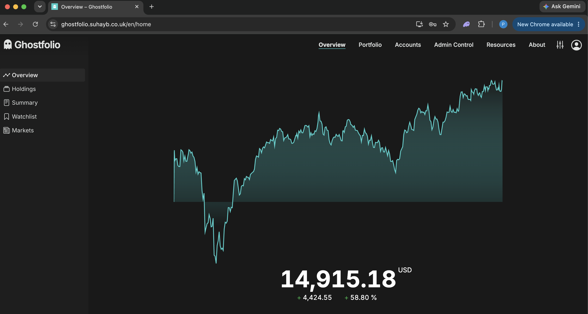
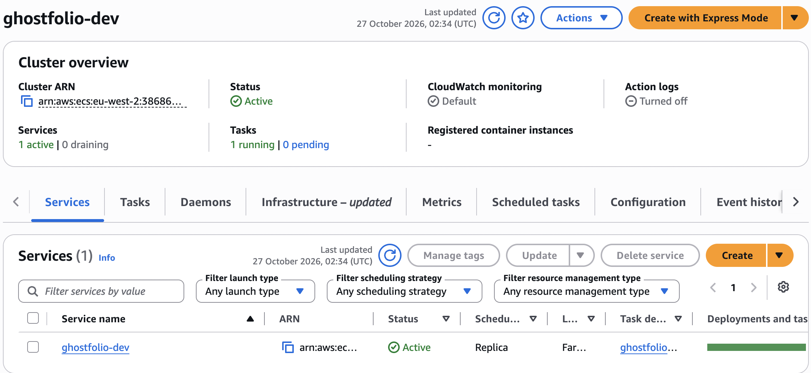
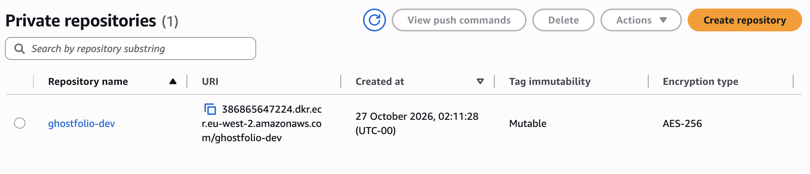
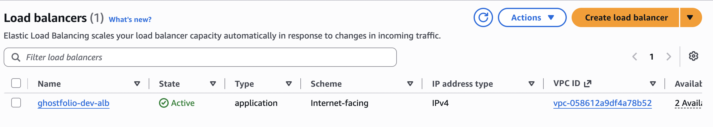
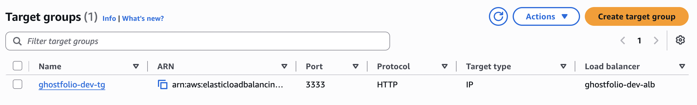
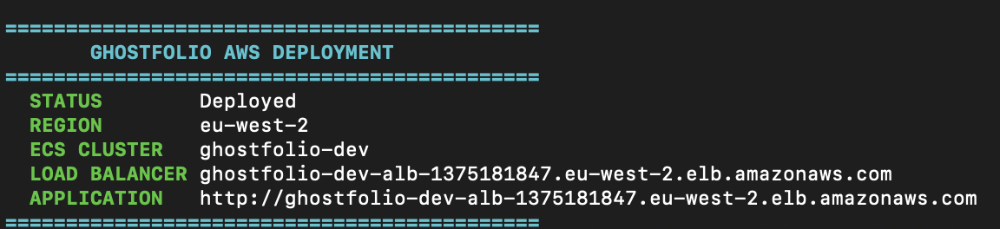
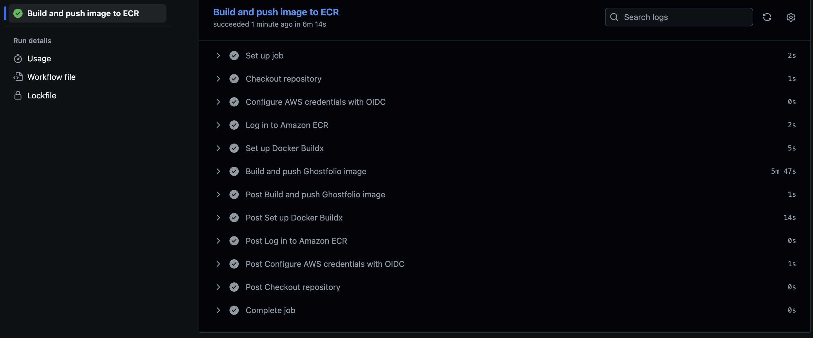
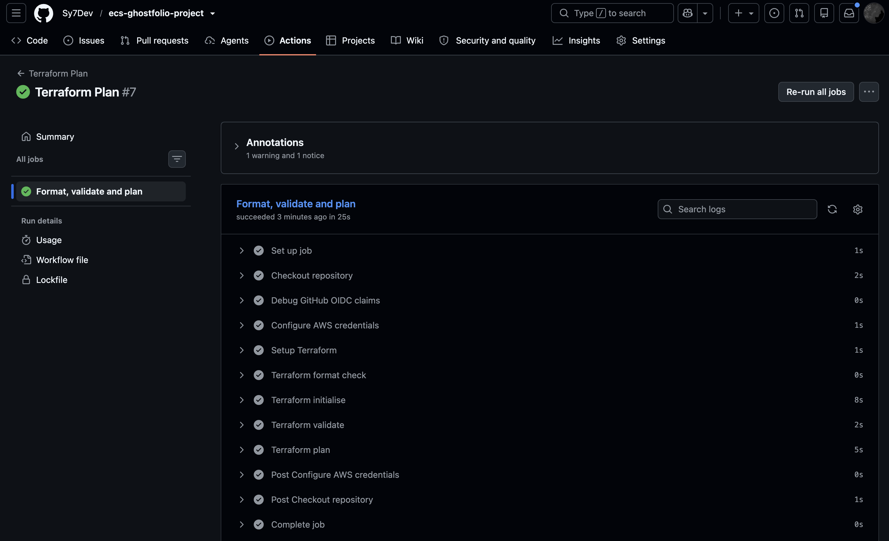
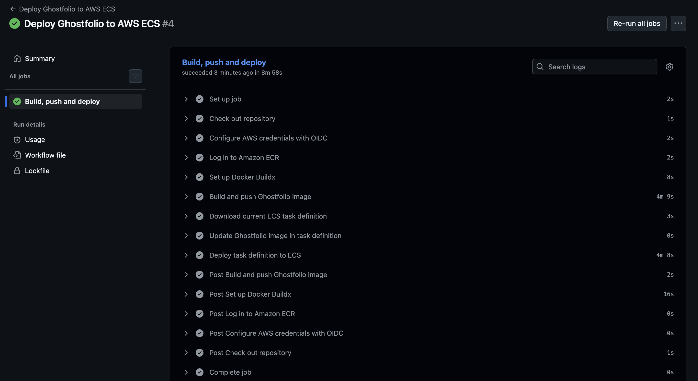

# Ghostfolio on AWS ECS Fargate

<p align="center">
  
  
  
  
  
  
  
  
</p>

<p align="center">
  
</p>

---

## Table of Contents

1. [Project Overview](#1-project-overview)
2. [Application URL](#2-application-url)
3. [Architecture Overview](#3-architecture-overview)
4. [Features](#4-features)
5. [Repository Structure](#5-repository-structure)
6. [Key Components](#6-key-components)
7. [Cost and Availability Decisions](#7-cost-and-availability-decisions)
8. [CI/CD Pipeline](#8-cicd-pipeline)
9. [Project Delivery](#9-project-delivery)
10. [Lessons Learned](#10-lessons-learned)
11. [Future Improvements](#11-future-improvements)

---

## 1. Project Overview

This project explores the deployment of **Ghostfolio**, an open-source personal finance and investment portfolio tracking application, to Amazon Web Services (AWS).

The goal was to take an existing application and build the cloud infrastructure and deployment process around it.

I used Docker to package the application, Terraform to define the AWS infrastructure, and GitHub Actions to automate application builds, infrastructure management and deployment.

The application runs on **Amazon ECS using Fargate**, with PostgreSQL for database storage and Redis for caching.

This project brought together containerisation, cloud infrastructure, networking, IAM permissions and CI/CD in a practical deployment scenario.

## 2. Application URL

**Application:** [https://ghostfolio.suhayb.co.uk](https://ghostfolio.suhayb.co.uk)

The application uses a custom subdomain, with DNS managed through Fasthosts.

HTTPS is configured using AWS Certificate Manager and an Application Load Balancer.

<p align="center">
  
</p>

## 3. Architecture Overview

The architecture is built around two main flows: application traffic and the deployment process.

### Application traffic

1. A user accesses the application through the custom domain.
2. Fasthosts DNS directs the request towards the AWS Application Load Balancer.
3. The load balancer handles HTTPS traffic using an ACM certificate.
4. Traffic is forwarded to the Ghostfolio container running on ECS Fargate.
5. Ghostfolio communicates with PostgreSQL and Redis within the ECS task.

### Deployment flow

1. Changes are pushed to the GitHub repository or a workflow is manually triggered.
2. GitHub Actions authenticates with AWS using OpenID Connect (OIDC).
3. Docker Buildx builds the application image for Linux ARM64.
4. The image is tagged and pushed to Amazon ECR.
5. The application deployment workflow updates the ECS task definition with the new image.
6. ECS deploys the updated task definition and waits for the service to stabilise.

The architecture diagram illustrates how the AWS services, application containers and deployment workflows fit together.

## 4. Features

- **Containerised application:** Ghostfolio is packaged into a Docker image.
- **AWS ECS Fargate:** Runs the application without requiring direct EC2 instance management.
- **Container registry:** Amazon ECR stores the built Docker images.
- **Database and caching:** PostgreSQL and Redis run alongside Ghostfolio in the ECS task.
- **HTTPS access:** An Application Load Balancer and AWS Certificate Manager handle secure incoming traffic.
- **Infrastructure as Code:** Terraform defines the AWS infrastructure.
- **Automated CI/CD:** GitHub Actions automates application builds and deployment workflows.
- **AWS authentication:** GitHub Actions uses OIDC to authenticate with AWS without storing long-lived AWS access keys.
- **ARM64 support:** Docker Buildx builds the application image for Linux ARM64.

## 5. Repository Structure

The repository separates application source code, infrastructure, deployment configuration and supporting documentation.

```text
ecs-ghostfolio-project/
│
├── .github/
│   └── workflows/             # GitHub Actions workflows
│
├── app/                       # Application source code
│   ├── apps/                  # Application services
│   ├── libs/                  # Shared libraries and components
│   ├── prisma/                # Database schema and migrations
│   ├── test/                  # Tests and test resources
│   ├── tools/                 # Build and development utilities
│   └── ...                    # Application configuration
│
├── assets/                    # Architecture diagrams and screenshots
│
├── infrastructure/
│   └── terraform/             # Terraform configuration and resources
│
├── .gitignore
├── Dockerfile                 # Application container image definition
├── README.md                  # Project documentation
└── compose.yaml               # Local container orchestration
```

| Directory / File | Purpose |
|---|---|
| `.github/workflows/` | GitHub Actions workflows for builds, infrastructure and deployment |
| `app/` | Ghostfolio application source code and configuration |
| `assets/` | Architecture diagrams and project screenshots |
| `infrastructure/terraform/` | Terraform configurations for AWS infrastructure |
| `Dockerfile` | Defines the application container image |
| `compose.yaml` | Defines the local multi-container environment |
| `README.md` | Project overview, architecture and documentation |

## 6. Key Components

### Amazon ECS and Fargate

ECS manages the application containers, while Fargate provides the compute capacity to run them without directly managing EC2 instances.

<p align="center">
  
</p>

### Running Containers

The ECS task is configured to run three containers:

- Ghostfolio
- PostgreSQL
- Redis

Keeping these containers within the same ECS task provides a straightforward deployment structure for the project.

<p align="center">
  
</p>

### Amazon ECR

Amazon Elastic Container Registry stores the Docker images used by the ECS deployment.

The GitHub Actions application pipeline pushes the built image to ECR before the application deployment workflow updates the ECS task definition.

<p align="center">
  
</p>

### Application Load Balancer

The Application Load Balancer provides an entry point for incoming application traffic and handles HTTPS connections.

It forwards traffic to the application through its configured target group.

<p align="center">
  
</p>

### Target Group

The target group connects the load balancer to the application running inside ECS.

<p align="center">
  
</p>

### Terraform

Terraform was used to define and provision the AWS infrastructure.

Managing infrastructure as code makes the configuration easier to organise, review and reproduce.

<p align="center">
  
</p>

### Other Technologies

| Component | Role in the project |
|---|---|
| **AWS Certificate Manager** | Provides the SSL/TLS certificate for HTTPS |
| **AWS IAM** | Controls permissions for AWS services and GitHub Actions |
| **GitHub OIDC** | Allows GitHub Actions to authenticate with AWS without long-lived access keys |
| **Docker Buildx** | Builds the application image for ARM64 |
| **PostgreSQL** | Stores application data |
| **Redis** | Provides caching |
| **Fasthosts** | Manages the custom domain and DNS records |

## 7. Cost and Availability Decisions

A key consideration when designing the infrastructure was choosing services that reduced server management while keeping the deployment straightforward.

### AWS Fargate

Fargate was chosen to run containers without provisioning or maintaining EC2 instances.

It also allowed the application to be deployed using a defined ECS task configuration.

### ARM64 Architecture

The Docker image was built for Linux ARM64 to support ARM-based AWS compute, including Graviton-powered infrastructure.

This provides an opportunity for improved price-performance compared with equivalent x86-based workloads.

### Application Load Balancer

The Application Load Balancer provides a single entry point for incoming application traffic and handles HTTPS termination.

It also separates public access from the application containers.

### Resource Management

The application, database and Redis are configured as containers within a single ECS task.

This keeps the initial deployment architecture relatively straightforward.

The trade-off is that the containers share the task's available compute resources and lifecycle.

## 8. CI/CD Pipeline

GitHub Actions is used to automate application builds, infrastructure planning, infrastructure deployment and application deployment.

The project uses separate workflows to keep application delivery and infrastructure management organised.

### Application Pipeline – Build and Push to ECR

The application pipeline builds the Ghostfolio Docker image and publishes it to Amazon ECR.

The workflow:

1. Checks out the repository.
2. Authenticates with AWS using GitHub OIDC.
3. Logs in to Amazon ECR.
4. Builds the Docker image using Docker Buildx.
5. Builds for Linux ARM64.
6. Tags the image using the Git commit SHA and `latest`.
7. Pushes the image to Amazon ECR.

**Application Pipeline evidence**

<p align="center">
  
</p>

### Terraform Plan

The Terraform Plan workflow validates and plans infrastructure changes before deployment.

This provides visibility into the resources Terraform intends to create, update or destroy before changes are applied.

**Terraform Plan evidence**

<p align="center">
  
</p>

### Terraform Deploy – Infrastructure Provisioning

The Terraform Deploy workflow is manually triggered and applies the infrastructure plan to provision the required AWS resources.

This separates infrastructure provisioning from the application build and deployment processes.

**Terraform Deploy evidence**

<p align="center">
  
</p>

### Deploy Ghostfolio to AWS ECS

The application deployment workflow deploys the Ghostfolio container image to the existing AWS ECS Fargate service.

It retrieves the existing ECS task definition, updates the Ghostfolio container image with the version stored in Amazon ECR and deploys the revised task definition.

The workflow also waits for the ECS service to reach a stable state.

**Deploy Ghostfolio to AWS ECS evidence**

<p align="center">
  
</p>

### AWS Authentication with OIDC

Instead of storing permanent AWS access keys as GitHub secrets, OIDC allows GitHub Actions to assume an IAM role.

This avoids maintaining long-lived credentials and uses an IAM trust relationship to control access.

### Deployment Workflow

```text
Developer
   |
   v
GitHub Repository
   |
   v
GitHub Actions
   |
   v
AWS Authentication (OIDC)
   |
   v
Docker Buildx
   |
   v
Amazon ECR
   |
   v
Update ECS Task Definition
   |
   v
Deploy to ECS Fargate
```

### Infrastructure Cleanup

A separate Terraform Destroy workflow is available for infrastructure cleanup.

ECR repositories containing images can prevent deletion unless their contents are handled appropriately. The destroy workflow therefore needs to account for ECR image cleanup before the repository can be removed.

## 9. Project Delivery

The project brought together several areas of DevOps and cloud engineering.

The main implementation work included:

- Preparing Ghostfolio for containerised deployment.
- Creating a Docker image targeting Linux ARM64.
- Defining AWS infrastructure using Terraform.
- Configuring ECS Fargate to run Ghostfolio, PostgreSQL and Redis.
- Setting up ECR as the container image registry.
- Configuring an Application Load Balancer and HTTPS.
- Connecting a custom domain through Fasthosts DNS.
- Setting up GitHub Actions with AWS OIDC authentication.
- Creating workflows for application builds, infrastructure planning and infrastructure deployment.
- Creating an application deployment workflow to update the running ECS service.

The result is a deployment setup connecting source control, container builds, AWS infrastructure and application deployment into a repeatable workflow.

## 10. Lessons Learned

Working through this project helped me understand how the different parts of a cloud deployment fit together.

Some of the main lessons were:

- **Containerisation:** Building an image for an existing application requires understanding its build process, dependencies and runtime configuration.
- **ECS task design:** Running multiple containers in one task requires careful consideration of networking, ports, environment variables and resource allocation.
- **IAM and OIDC:** Connecting GitHub Actions to AWS requires the correct IAM role permissions and trust relationship.
- **Networking:** Understanding how DNS, load balancers, security groups and container ports work together is essential for making an application accessible.
- **Infrastructure as Code:** Terraform makes infrastructure easier to define, review and reproduce.
- **CI/CD:** Automating image builds and deployments reduces manual deployment steps and makes the process more repeatable.

## 11. Future Improvements

There are several areas where the project could be extended:

- **Automated testing:** Add tests to the GitHub Actions workflow before building and deploying the image.
- **Deployment verification:** Add application health checks after deployment to verify that Ghostfolio is responding correctly.
- **Improved rollback:** Introduce a clearer rollback process for failed deployments.
- **Monitoring and alerting:** Expand monitoring and create alerts for application and infrastructure issues.
- **Database backups:** Introduce a managed and automated backup strategy for PostgreSQL.
- **Secrets management:** Review and expand the use of AWS Systems Manager Parameter Store for application configuration and secrets.
- **Environment separation:** Introduce separate development and production environments.
- **Automated deployments:** Consider triggering deployments automatically when changes are merged into the main branch.
